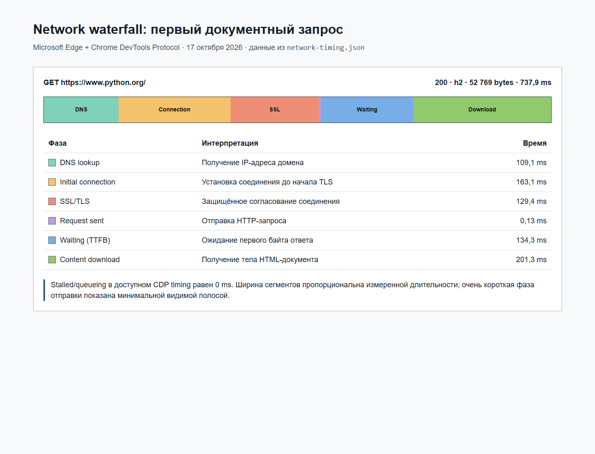
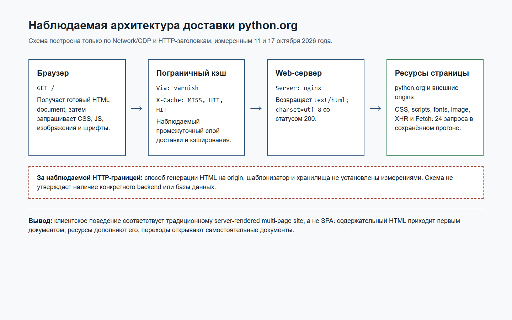

# Практика 1. Жизненный цикл HTTP-запроса и рабочее окружение

Ветка: `feature/week1-report`

Дата измерений: 2026-10-11.

Использованные инструменты:

- Windows PowerShell.
- `git`, `node`, `python`, `curl.exe`.
- Microsoft Edge headless через Chrome DevTools Protocol.
- Node.js audit script: `tools/browser-http-audit.mjs`.

## СРС №1. Анализ публичного сайта

Исследуемый сайт: `https://www.python.org/`. Основной Network-прогон выполнен 11 октября 2026 года; недостающие фазы и redirect chain проверены 17 октября 2026 года.

### Матрица требований

| Требование лекции 1 | Статус | Доказательство |
| --- | --- | --- |
| Waterfall с подписанными фазами первого запроса | Подтверждено | `docs/practice1/python-evidence/network-waterfall.png`; исходные CDP timing в `network-timing.json` |
| 10 реальных HTTP-запросов | Подтверждено | Таблица в разделе 6; полный прогон из 24 запросов в `normal.json` |
| `curl -sIL` и объяснение redirect chain | Подтверждено | `curl-python-redirects.txt` и объяснение ниже |
| Схема архитектуры | Подтверждено | `architecture.png`, редактируемый источник `architecture.html` |
| Вывод SPA / статика / SSR | Подтверждено с оговоркой | Наблюдаемое поведение соответствует SSR/традиционному MPA; внутренняя генерация HTML не наблюдаема |

### Waterfall первого запроса



Снимок построен по настоящему `Network.responseReceived.response.timing` и `Network.loadingFinished` из Edge CDP, а не по вымышленным значениям. Запрос `GET https://www.python.org/` завершился статусом 200 по HTTP/2: 52 769 bytes за 737,9 ms. Измерены DNS 109,1 ms, соединение до TLS 163,1 ms, SSL 129,4 ms, отправка 0,13 ms, ожидание первого байта 134,3 ms и загрузка содержимого 201,3 ms. Stalled/queueing в доступном CDP timing равен 0 ms.

### Десять запросов

Таблица с методом, кодом, типом и размером приведена в разделе 6. Это первые 10 записей фактического CDP-прогона из 24 запросов; исходные URL и ответы сохранены в `docs/practice1/python-evidence/normal.json`.

### Redirect chain через `curl -sIL`

Выполнена команда:

```powershell
curl.exe -sIL https://python.org
```

Существенные строки настоящего вывода:

```text
HTTP/1.1 301 Moved Permanently
Location: https://www.python.org/

HTTP/1.1 200 OK
content-type: text/html; charset=utf-8
```

Первый HEAD-запрос к домену без `www` получает постоянный редирект 301. Параметр `-L` следует по `Location` на канонический HTTPS URL, который отвечает 200 и HTML-документом. `-s` отключает progress output, `-I` запрашивает только заголовки. Полный неизменённый вывод сохранён в `docs/practice1/python-evidence/curl-python-redirects.txt`.

### Наблюдаемая архитектура и вывод



По критериям курса сайт ближе всего к **SSR / традиционному multi-page site**, а не к SPA:

1. Первый Document response уже содержит содержательный HTML; интерфейс не начинается с пустого shell, ожидающего единый JS bundle.
2. CSS, обычные scripts, шрифты и изображение загружаются как дополнения к документу; сохранённый прогон не показывает клиентский router.
3. HTTP-заголовки наблюдаемо показывают цепочку Varnish (`Via`, `X-Cache`) и nginx (`Server`), а переходы ведут к самостоятельным документам.

Network не позволяет доказать, генерируется ли HTML на origin для каждого запроса или заранее. Поэтому схема фиксирует только видимую цепочку доставки и не утверждает наличие конкретного backend, шаблонизатора или базы данных.

---

## Приложение. Результаты практического занятия 1

## 1. Проверка окружения

Команды выполнены локально 2026-10-11.

| Команда | Фактический результат | Статус |
| --- | --- | --- |
| `git --version` | `git version 2.43.0.windows.1` | OK |
| `node -v` | `v22.14.0` | OK |
| `python --version` | `Python 3.11.1` | Требуется Python 3.12 по syllabus |
| `curl.exe --version` | `curl 8.21.0 (Windows) libcurl/8.21.0 Schannel zlib/1.3.2 ...` | OK |
| `git config user.name` | `Garynych271` | OK |
| `git config user.email` | `garynych271@example.com` | OK |

Примечание для Windows PowerShell: команда `curl` без `.exe` является алиасом `Invoke-WebRequest`; для настоящего curl в отчете используется `curl.exe`.

SSH-ключи найдены в `$HOME\.ssh`: `id_ed25519`, `id_ed25519.pub`, `known_hosts`. Подключение к GitHub SSH не проверялось, чтобы не выполнять авторизационные действия без необходимости.

Удаленный репозиторий:

```text
origin  https://github.com/Garynych271/booknest-ayubaev.git (fetch)
origin  https://github.com/Garynych271/booknest-ayubaev.git (push)
```

## 2. DevTools/CDP Network: учебная страница

URL учебной страницы: `https://developer.mozilla.org/en-US/docs/Web/HTTP/Guides/Overview`

Данные сняты автоматически через Microsoft Edge headless и CDP. Доказательства сохранены:

- `docs/practice1/evidence/normal.json`
- `docs/practice1/evidence/normal.png`
- `docs/practice1/evidence/slow-4g.json`
- `docs/practice1/evidence/slow-4g.png`
- `docs/practice1/evidence/offline.json`
- `docs/practice1/evidence/offline.png`
- `docs/practice1/evidence/summary.json`

### Сводка Network

| Метрика | Значение |
| --- | --- |
| Число запросов | 83 |
| Передано по сети / transferred | 528189 bytes |
| Время `DOMContentLoaded` | 1626 ms |
| Время загрузки / load | 2268 ms |
| Код документного запроса | 200 |
| MIME document | `text/html` |

### Типы ресурсов

| Тип ресурса | Количество | Пример пути |
| --- | ---: | --- |
| Document | 1 | `/en-US/docs/Web/HTTP/Guides/Overview` |
| Stylesheet | 17 | `/static/client/styles...css` |
| Script | 39 | `/static/client/...js` |
| Image | 14 | `/pimg/...jpg` |
| Font | 3 | `/static/client/inter-latin...woff2` |
| Fetch | 2 | MDN API/telemetry request |
| Ping | 4 | telemetry ping |
| Manifest | 1 | manifest |
| Other | 2 | browser/auxiliary request |

Самые крупные загруженные ресурсы:

| Тип | Код | Размер | URL |
| --- | ---: | ---: | --- |
| Font | 200 | 117436 | `https://developer.mozilla.org/static/client/inter-italic-latin.fd2627ec16333c05.woff2` |
| Font | 200 | 106741 | `https://developer.mozilla.org/static/client/inter-latin.9a3b1bc220d426ef.woff2` |
| Image | 200 | 38827 | `https://developer.mozilla.org/pimg/...` |
| Font | 200 | 29516 | `https://developer.mozilla.org/static/client/jetbrains-mono-latin.119994ed445212c7.woff2` |
| Document | 200 | 28952 | `https://developer.mozilla.org/en-US/docs/Web/HTTP/Guides/Overview` |

## 3. Запрос документа

Документный запрос: `https://developer.mozilla.org/en-US/docs/Web/HTTP/Guides/Overview`

### Request headers

| Header | Значение | Назначение |
| --- | --- | --- |
| `Upgrade-Insecure-Requests` | `1` | Браузер сообщает, что предпочитает защищенную HTTPS-навигацию. |
| `User-Agent` | `Mozilla/5.0 ... HeadlessChrome/154.0.0.0 ... Edg/154.0.0.0` | Идентифицирует браузерный движок и версию клиента для сервера. |
| `sec-ch-ua` | `"Chromium";v="154", "Microsoft Edge";v="154", "Not A(Brand";v="99"` | Client Hints с брендом и версией браузера. |
| `sec-ch-ua-mobile` | `?0` | Указывает, что запрос выполнен не с мобильного устройства. |
| `sec-ch-ua-platform` | `"Windows"` | Передает платформу клиента через Client Hints. |

### Response headers

| Header | Значение | Назначение |
| --- | --- | --- |
| `content-type` | `text/html` | Тип содержимого: HTML-документ. |
| `cache-control` | `public, max-age=3600` | Разрешает публичное кэширование на 1 час. |
| `content-encoding` | `br` | Браузер получил Brotli-сжатую версию ответа. |
| `strict-transport-security` | `max-age=63072000` | HSTS: браузер должен использовать HTTPS для домена. |
| `x-frame-options` | `DENY` | Запрещает встраивание страницы во frame, снижая риск clickjacking. |

## 4. Сравнение с `curl.exe -i`

Команда:

```powershell
curl.exe -i -L https://developer.mozilla.org/en-US/docs/Web/HTTP/Guides/Overview -o docs\practice1\evidence\curl-mdn-overview.txt
```

Файл результата: `docs/practice1/evidence/curl-mdn-overview.txt`.

Краткий фрагмент ответа:

```text
HTTP/1.1 200 OK
Connection: keep-alive
Content-Length: 228647
strict-transport-security: max-age=63072000
cache-control: public, max-age=3600
server: Google Frontend
content-type: text/html
last-modified: Sun, 11 Oct 2026 01:22:13 GMT
x-content-type-options: nosniff
x-frame-options: DENY
```

Сравнение с браузером:

| Наблюдение | Browser DevTools/CDP | `curl.exe -i` |
| --- | --- | --- |
| HTTP status | 200 | 200 |
| Content-Type | `text/html` | `text/html` |
| Compression | `content-encoding: br`, encoded document около 28 KB | без `content-encoding` в сохраненном ответе, `Content-Length: 228647` |
| Client identity | Edge/HeadlessChrome User-Agent и Client Hints | curl User-Agent не совпадает с браузером |
| Cache headers | `cache-control`, `age`, `x-cache` видны | `cache-control`, `age`, `x-cache` видны |

Вывод: браузер и `curl.exe` получили один и тот же HTML-документ со статусом 200, но браузер отправил browser-specific headers и получил сжатую Brotli-версию, поэтому объем document transfer в браузере меньше, чем `Content-Length` у `curl.exe`.

## 5. Slow 4G и Offline

Данные сняты через CDP `Network.emulateNetworkConditions` с отключенным кэшем.

### Slow 4G

| Что измерить | Наблюдение |
| --- | --- |
| Число запросов | 83 |
| Передано по сети | 528207 bytes |
| Время `DOMContentLoaded` | 5243 ms |
| Время `load` | 12183 ms |
| Самые долгие/заметные ресурсы | В waterfall сильнее заметны font, image и script resources; полный список в `docs/practice1/evidence/slow-4g.json`. |
| Что видно в waterfall | При том же числе ресурсов загрузка растянулась: `load` увеличился с 2268 ms до 12183 ms. |

### Offline

| Что измерить | Наблюдение |
| --- | --- |
| Число запросов | 5 |
| Ошибка навигации | `net::ERR_INTERNET_DISCONNECTED` |
| Ошибка document request | `net::ERR_INTERNET_DISCONNECTED` |
| Время завершения сценария | 413 ms |
| Что отличается от Slow 4G | Slow 4G загружает страницу медленно, но успешно; Offline не получает документ и показывает браузерную error page. |

## 6. Самостоятельная часть: 10 запросов любого сайта

Выбранный сайт: `https://www.python.org`

Данные сняты через Edge headless/CDP. Доказательства:

- `docs/practice1/python-evidence/normal.json`
- `docs/practice1/python-evidence/normal.png`
- `docs/practice1/python-evidence/summary.json`

Сводка: 24 запроса, 527975 bytes transferred, `DOMContentLoaded` 1735 ms, `load` 1846 ms.

| # | Метод | Путь | Код | Тип | Размер |
| ---: | --- | --- | ---: | --- | ---: |
| 1 | GET | `/` | 200 | Document | 52802 |
| 2 | GET | `/js/script.file-downloads.outbound-links.js` | 200 | Script | 1953 |
| 3 | GET | `/static/js/libs/modernizr.js` | 200 | Script | 5379 |
| 4 | GET | `/static/stylesheets/style.6cb9f297dd80.css` | 200 | Stylesheet | 125660 |
| 5 | GET | `/static/stylesheets/mq.a4feecea96fa.css` | 200 | Stylesheet | 17785 |
| 6 | GET | `/static/stylesheets/font-awesome.bf0c425cdb73.css` | 200 | Stylesheet | 7273 |
| 7 | GET | `/ajax/libs/jqueryui/1.12.1/themes/smoothness/jquery-ui.css` | 200 | Stylesheet | 9038 |
| 8 | GET | `/static/img/python-logo.png` | 200 | Image | 15996 |
| 9 | GET | `/ajax/libs/jquery/1.8.2/jquery.min.js` | 200 | Script | 33758 |
| 10 | GET | `/ajax/libs/jqueryui/1.12.1/jquery-ui.min.js` | 200 | Script | 68081 |

Архитектура по наблюдаемому клиентскому поведению: server-rendered multi-page site, не SPA. По одним HTTP-измерениям нельзя отличить динамическую генерацию на origin от заранее созданного HTML.

Три наблюдаемых признака:

1. Первый request `/` возвращает готовый HTML document со статусом 200; контент не строится единственным JS bundle после пустого shell.
2. Загружаются обычные CSS, jQuery/Modernizr scripts, изображение логотипа и шрифты; нет признака клиентского router для single-page navigation.
3. Document URL `/` является самостоятельной HTML-страницей; ресурсы выступают как enhancement, а не как единственный источник контента.

## 7. Challenge task

Не выполнялось в этом сеансе, так как это дополнительное задание.

## 8. Самопроверка

- [x] Отчет создан в ветке `feature/week1-report`.
- [x] Локальное окружение проверено реальными командами.
- [x] Заполнены реальные DevTools/CDP Network данные.
- [x] Выполнен настоящий `curl.exe -i` для выбранного документа.
- [x] Таблица из 10 запросов заполнена реальными данными.
- [x] Архитектура сайта обоснована тремя наблюдаемыми признаками.
- [x] Добавлен подписанный waterfall первого запроса на основе Edge CDP timing.
- [x] Выполнен настоящий `curl.exe -sIL` и объяснена цепочка 301 → 200.
- [x] Добавлена редактируемая схема наблюдаемой архитектуры.
- [x] PR №1 открыт из ветки, не из `main` (подтверждено пользователем).

